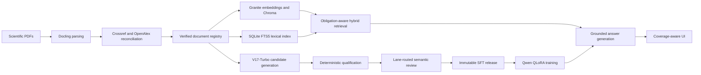

# LLM for Academic Research 
LLM for Academic Research is an evidence-grounded research pipeline for scientific literature. The repository combines verified document ingestion, hybrid obligation-aware retrieval, V17-Turbo synthetic-data generation, QLoRA supervised fine-tuning, held-out evaluation, and a coverage-aware user interface.

The repository contains framework code and policy documentation only. Papers, parsed corpora, vector databases, generated datasets, model weights, adapters, checkpoints, credentials, and run artifacts are intentionally excluded.

## Architecture



## Framework components

1. **Parsing, metadata, embedding, and indexing**
   - Docling native extraction with bounded OCR fallback.
   - Scholarly identity reconciliation through PDF evidence, Crossref, and OpenAlex.
   - SHA-256-bound document and chunk registries.
   - Granite embeddings in Chroma plus a matching SQLite FTS5 lexical index.

2. **Obligation-evidence retrieval**
   - Dense and lexical candidate fusion, reranking, source diversity, and context deduplication.
   - Obligation-first retrieval and explicit coverage validation before decoding.
   - Page, section, document, and citation provenance retained through the answer path.

3. **V17-Turbo SFT generation**
   - Single-source, multi-source, table, and comparison lanes.
   - Evidence-backed obligation ledgers and answer-unit mappings.
   - Capacity lanes that preserve answer completeness without legacy word ceilings.
   - Deterministic qualification followed by independent, lane-routed semantic review.

4. **Fine-tuning and evaluation**
   - QLoRA/NF4 fine-tuning for the Qwen student with memory canaries and immutable releases.
   - Validation-loss checkpointing and frozen held-out evaluation.
   - Exact tokenizer alignment between materialization, training, and serving.

5. **Research UI**
   - Standard and long-form capacity modes.
   - Visible evidence coverage, citations, source identities, and incomplete-coverage states.
   - Fail-closed behavior when the active model or index does not match its release binding.

## Repository layout

```text
config/                 Portable example configuration
guidebook/              Canonical policy and protocol documents
scripts/                Ingestion and DGX Spark orchestration tools
src/giis_prod/          Pipeline implementation
tests/                  Deterministic policy and implementation tests
giis_pipeline.py        Consolidated command-line entry point
```

## Installation

Python 3.11 or newer is required.

```bash
python -m venv .venv
source .venv/bin/activate
python -m pip install --upgrade pip
python -m pip install -e '.[test]'
cp config/settings.example.toml config/settings_v17_turbo.toml
cp .env.example .env
```

Model serving and QLoRA training require the optional runtime dependencies and compatible accelerator drivers:

```bash
python -m pip install -e '.[serve,train-4bit]'
```

Supply credentials only through environment variables. In particular, use `GIIS__METADATA__OPENALEX_API_KEY` for OpenAlex, `TEACHER_API_KEY` for the teacher endpoint, and `VLLM_API_KEY` for the inference endpoint. Real `.env` files are ignored.

## Typical workflow

```bash
# Inspect available commands
python giis_pipeline.py --help

# Run the test suite
pytest
```

Copy `config/settings.example.toml` before a run and adapt corpus locations, model identifiers, scale controls, and deployment ports. Run-specific selection manifests and frozen release bindings are generated locally and must remain associated with their corresponding corpus and artifacts.

## Canonical policies

- [Parsing, metadata, embedding, and hybrid-index policy](guidebook/PARSING_EMBEDDING_AND_HYBRID_INDEX_POLICY.md)
- [V17-Turbo policy](guidebook/V17_TURBO_POLICY.md)
- [V17-Turbo execution protocol](guidebook/V17_TURBO_PROTOCOL.md)
- [Reviewer benchmark and hybrid semantic-review rationale](guidebook/REVIEWER_BENCHMARK_AND_HYBRID_SEMANTIC_REVIEW.md)
- [UI policy](guidebook/UI_POLICY.md)

The policy documents define the canonical behavior. Configuration and executables must implement those controls without weakening release gates.

## Data and model governance

This repository does not grant redistribution rights for source papers or third-party model weights. Operators are responsible for the licenses and access terms governing their corpora, models, APIs, and generated releases.

