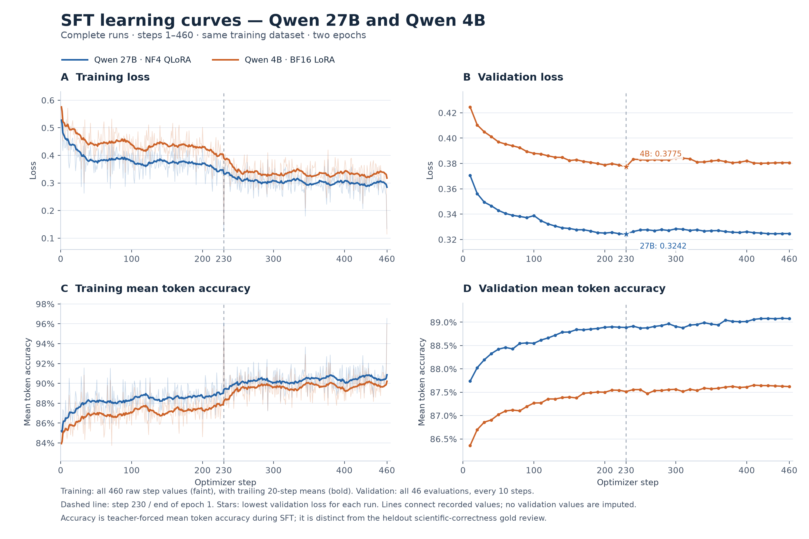

# Qwen 27B and 4B supervised fine-tuning results

Qwen3.8-27B (NF4 QLoRA) and Qwen3.5-4B (BF16 LoRA) used the same v17-Turbo release of 3,665 training examples and 406 validation examples, with completion-only loss. Both runs completed two epochs and 460 optimizer steps. Each run logged training metrics at every step and evaluated the validation split every 10 steps.

Faint training lines show the logged values. Bold training lines show trailing 20-step means. Validation points are the 46 recorded evaluations per model. The dashed line marks the end of epoch 1 at step 230, and the stars mark the minimum validation losses.

| Run | Best validation loss (step) | Final validation loss (step 460) | Peak validation mean token accuracy (step) | Final validation mean token accuracy (step 460) |
| --- | ---: | ---: | ---: | ---: |
| Qwen3.8-27B, NF4 QLoRA | 0.324205 (230) | 0.324649 | 89.0825% (450) | 89.0757% |
| Qwen3.5-4B, BF16 LoRA | 0.377465 (230) | 0.380625 | 87.6522% (410) | 87.6204% |

Both runs reached their lowest validation loss at the end of epoch 1. Training loss continued to fall and training mean token accuracy continued to rise overall during epoch 2. Validation loss fluctuated above its minimum, and both runs reached peak validation token accuracy later than their minimum loss. Checkpoint selection used validation loss.

Mean token accuracy measures next-token prediction against the reference completion under teacher forcing. Held-out generation, scientific correctness, and citation support are evaluated separately. The runs differ in model family, size, and fine-tuning configuration, so the curves describe the observed runs without isolating the effect of any one factor.

The [metric log](qwen-sft-metrics.csv) contains the unaggregated loss and mean token accuracy from the final checkpoint trainer histories, with 460 training rows and 46 validation rows per run. Accuracy is stored as a fraction in the CSV and displayed as a percentage here.
